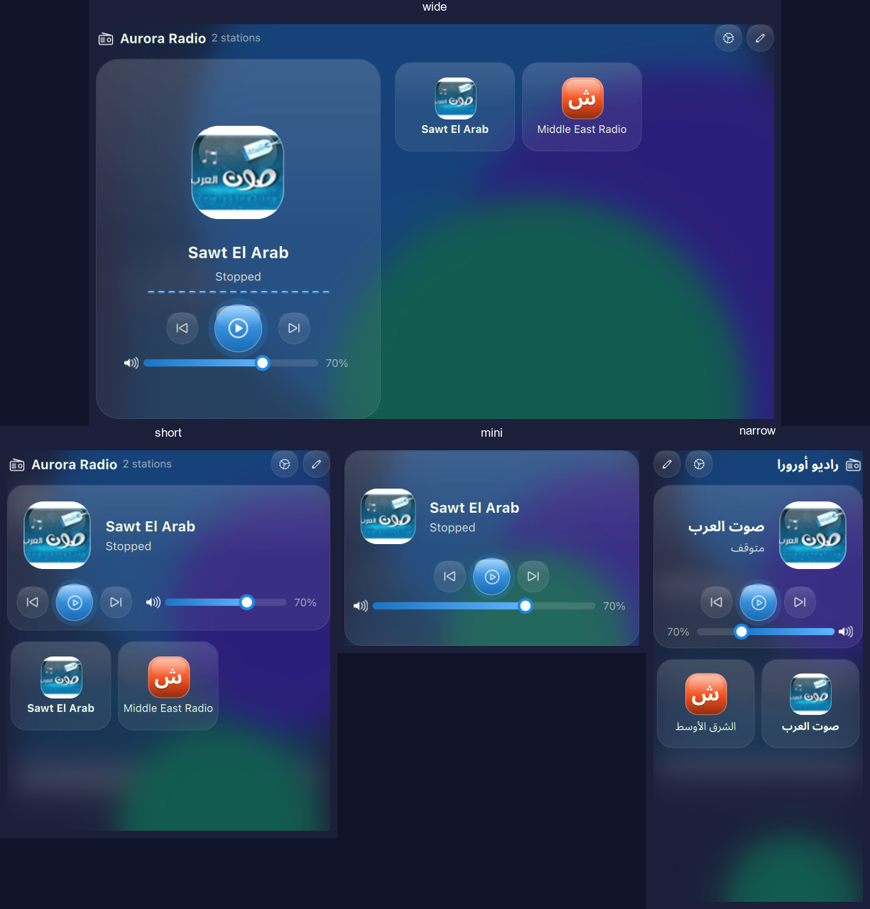

# Aurora Radio — راديو أورورا

**Live radio from around the world, in a frosted-glass widget for KDE Plasma 6.**
Discover tens of thousands of stations, add any stream link, and play your own music files, folders
and playlists. It works with Plasma's media controller, with audio visualizers and with your media
keys.

[العربية ⬇](#بالعربي) · [Install](#install) · [User guide](#user-guide) · [Troubleshooting](#troubleshooting) · [For developers](#for-developers)

<p align="center">
  
  
  
</p>

---

## Features

| | |
|---|---|
| 🌍 **Discover** | Search the open [Radio Browser](https://www.radio-browser.info) directory (tens of thousands of stations in 220+ countries) by name, country and genre. Your country is preselected. Arabic searches also find Latin spellings: فيروز ↔ Fairuz, أم كلثوم ↔ Kalthom |
| ➕ **Add anything** | A stream URL (mp3/aac/m3u8), a Dailymotion or YouTube live page, a local file, a music folder, or an M3U/PLS playlist, with shuffle |
| ✨ **Fetch from source** | One click fills in the station name, description and logo from the directory, the stream itself or the station website |
| 🎨 **Custom logos** | A glass letter or emoji, a system icon, an image from your computer or from a link, or the station's own logo |
| 🩺 **Check & repair** | Listens to every stream to confirm it actually carries audio. It finds moved files, restores missing logos and suggests replacement links after testing them for audio |
| 🎛 **MPRIS** | Appears in Plasma's media controller, in audio visualizers, on the lock screen and on the media keys, with the station name, song title and cover art |
| 📐 **Responsive** | Separate layouts for wide, normal, short, tiny and narrow sizes, on a panel or on the desktop |
| 🌐 **Multilingual** | English and Arabic, with left-to-right and right-to-left layouts. Follows the system language or can be set manually. New languages are easy to add |
| 🇪🇬 **Curated library** | Egypt's official public radio (Maspero): Sawt El Arab, Middle East Radio, Radio Masr, Holy Quran and more, one click each |

<p align="center"></p>

---

## Install

### 1. Requirements

Most of these are already installed on a typical Plasma desktop.

| Package | Used for |
|---|---|
| `mpv` | Playback |
| `yt-dlp` | Dailymotion / YouTube live pages |
| `ffmpeg` | Check & repair, which listens to each stream |
| `python3-gi` | The background service that publishes MPRIS |
| `imagemagick` | *Optional:* converts `.ico` favicons into logos |

```sh
# Debian / Ubuntu / KDE neon
sudo apt install mpv yt-dlp ffmpeg python3-gi imagemagick
# Fedora
sudo dnf install mpv yt-dlp ffmpeg python3-gobject ImageMagick
# Arch / Manjaro
sudo pacman -S mpv yt-dlp ffmpeg python-gobject imagemagick
```

> Keep `yt-dlp` up to date. Video sites change often, and an old `yt-dlp` is the most common reason
> video-page stations stop playing.

### 2. Install the widget (choose one)

**A. From Plasma (KDE Store):**
right-click the desktop or a panel → **Add Widgets…** → **Get New Widgets…** → **Download New Plasma
Widgets** → search for **Aurora Radio** → **Install**.

**B. From a `.plasmoid` file:**
download the latest `aurora-radio-x.y.z.plasmoid` from
[Releases](https://github.com/elblasy33/plasma_radio_deploy/releases), then:

```sh
kpackagetool6 -t Plasma/Applet -i aurora-radio-1.1.1.plasmoid
```

or go to **Add Widgets… → Get New Widgets… → Install Widget From Local File…**

**C. From source:**

```sh
git clone https://github.com/elblasy33/plasma_radio_deploy.git
cd plasma_radio_deploy
./install.sh --restart
```

### 3. Add it

Right-click a panel or the desktop → **Add Widgets…** → search for **Aurora Radio** and drag it where
you want it. On first run it opens with a welcome screen. Press **Discover stations** to browse
stations from your country.

### Update

- **KDE Store:** *Get New Widgets* shows an **Update** button.
- **Source:** run `git pull && ./install.sh --restart`.

### Uninstall

```sh
kpackagetool6 -t Plasma/Applet -r com.github.elblasy33.auroraradio
rm -f ~/.local/share/applications/aurora-radio.desktop     # media-controller icon entry
rm -rf ~/.local/share/aurora-radio ~/.cache/aurora-radio    # optional: saved logos and cover art
```

---

## User guide

### Panel icon

| Action | Result |
|---|---|
| Left click | Open the player |
| Middle click | Play / stop |
| Mouse wheel | Volume |
| Right click | Play/stop, next station, manage stations, settings |

While a station is playing, the panel icon shows that station's logo with a glowing ring.

### The player

- Click the **big logo** or the **play** button to play or stop. Local files pause instead of
  stopping.
- **⏮ / ⏭** switch station. On the keyboard: **Space** plays or stops, **← / →** change station,
  **↑ / ↓** change the volume.
- Click a station tile to play it. **Right-click** a tile to play, edit, duplicate or delete it.
- If you set **categories**, chips appear above the stations so you can filter them.

### Managing stations (✏️ button)

- **Discover**: search the world directory. Your country is preselected, and a name search covers
  every country with yours listed first. **▶** gives a quick listen and **＋** adds the station with
  its name, logo and country.
- **New**: add a station yourself.
  - **Source:** a *Stream link* (any URL or a Dailymotion/YouTube page), a *File*, a *Folder* or a
    *Playlist*.
  - **Fetch:** fills in the name, description and logo from the source.
  - **Logo:** a *Letter* (or emoji), an *Icon* from your icon theme, an *Image* from your computer
    or a link, or *From source*. Images are copied into the widget's own folder, so moving the
    original file is safe.
  - **Try:** listen before you save.
- **Import**: turns every entry of an `.m3u`/`.pls` file into a station.
- **Egyptian public radio (Maspero)**: a curated set of official stations, one click each.
- **Check**: see [Check & repair](#check--repair).
- The station list has buttons to reorder, edit, duplicate and delete.

### Check & repair

This listens to a few seconds of every station and reports what is wrong:

| Problem | What it means | Suggested fix |
|---|---|---|
| The source refuses (401/403) | The broadcaster closed the link or requires authorization | A replacement link from the directory, already tested for audio |
| Not found (404) / unreachable / timed out | The link is dead or the server is down | Same as above |
| No audio / silent | It connects, but there is no sound | Same as above |
| Path not found | A file or folder was moved | Finds it by name in Music, Downloads, Desktop, external drives and the rest of your home folder |
| Missing or online-only logo | The logo file is gone, or only exists online | Fetches it again, saves a local copy, or falls back to a glass letter |

Use **Fix** for one problem, **Fix all**, **Edit manually**, or **Ignore**.

### Settings (⚙ button, or right-click → Configure)

- **Appearance:** glass opacity, the animated aurora background and its strength, accent color (the
  station's or the system's), animations, logo shape (squircle, circle or soft square), grid or
  list, number of columns, category chips, equalizer, stream info, panel icon style, widget icon,
  and the station name next to the panel icon.
- **General:** **language** (automatic, English or العربية), MPRIS on or off, play the last station
  on login, and the mouse-wheel volume step.

---

## Troubleshooting

| Symptom | What to do |
|---|---|
| Dailymotion / YouTube stations don't play | Update `yt-dlp` (`sudo apt install --only-upgrade yt-dlp`, or `pipx upgrade yt-dlp`) |
| One station never plays | Run **Check**. If the source refuses or is silent, the problem is at the broadcaster. Pick the suggested replacement or remove the station |
| Not shown in the media controller or visualizer | Make sure **MPRIS** is enabled in Settings → General and that `python3-gi` is installed |
| A change doesn't appear after updating | Reload Plasma: `systemctl --user restart plasma-plasmashell` |
| Stop the background service by hand | `python3 ~/.local/share/plasma/plasmoids/com.github.elblasy33.auroraradio/contents/code/radioctl.py '{"cmd":"quit"}'` |

Please report bugs at [Issues](https://github.com/elblasy33/plasma_radio_deploy/issues).

---

## For developers

```
package/
├── metadata.json              plugin id, name, version
└── contents/
    ├── config/                settings schema (main.xml) and settings pages
    ├── ui/                    QML: main.qml (state), FullView, StationEditor, DiscoverPage,
    │                          HealthPage, glass components (GlassPanel, StationLogo, Aurora…)
    ├── code/
    │   ├── radiod.py          playback service: one mpv process, auto-reconnect, MPRIS on D-Bus
    │   ├── radioctl.py        client used by the widget (unix socket, one JSON request per call)
    │   ├── sources.py         directory search, countries, fetch from source, logos, audio check
    │   ├── presets.js         curated Maspero library, defaults per country, color palette, glyphs
    │   └── i18n.js            translations (Arabic text is the key, EN holds English)
    └── images/logos/          bundled station logos
```

- **Install while developing:** `./install.sh --restart`
- **Build a `.plasmoid` for a release or the store:** `./build.sh`, which writes
  `dist/aurora-radio-<version>.plasmoid`
- **Try it in a window:** `plasmoidviewer -a package`
- **Add a language:** add a table like `EN` in `code/i18n.js` and return it from `resolve()` and
  `tr()`.
- **Add a curated library:** add entries to `catalog` in `code/presets.js`. `defaults()` decides
  which stations a new user starts with, based on their country.
- **Data on disk:** saved logos are in `~/.local/share/aurora-radio/logos/` and rendered cover art is
  in `~/.cache/aurora-radio/art/`.

### Notes

- Station data comes from Radio Browser, which is community-maintained, so some entries go offline.
  **Check & repair** exists for exactly that.
- The Maspero stations are the broadcaster's public live pages. The widget plays them as a normal
  viewer would and does not get around any restriction.

---

## بالعربي

**راديو أورورا: ودجت لسطح مكتب KDE Plasma 6 لتشغيل إذاعات العالم بث مباشر، بواجهة زجاجية.** بيخليك تكتشف عشرات الآلاف من الإذاعات، وتضيف أي رابط بث، وتشغّل ملفات الموسيقى والمجلدات وقوائم التشغيل بتاعتك. وبيظهر في متحكم الوسائط بتاع Plasma وفي الـ Visualizer.

### التثبيت
1. **سطّب المتطلبات:**
   `sudo apt install mpv yt-dlp ffmpeg python3-gi imagemagick`
2. **سطّب الودجت بطريقة من دول:**
   - **من متجر KDE:** كليك يمين على سطح المكتب ← **إضافة عناصر واجهة** ← **احصل على عناصر جديدة** ← دوّر على **Aurora Radio**.
   - **من ملف:** نزّل ملف `.plasmoid` من [Releases](https://github.com/elblasy33/plasma_radio_deploy/releases) وشغّل:
     `kpackagetool6 -t Plasma/Applet -i aurora-radio-1.1.1.plasmoid`
   - **من المصدر:**
     `git clone https://github.com/elblasy33/plasma_radio_deploy.git && cd plasma_radio_deploy && ./install.sh --restart`
3. **ضيفه:** من **إضافة عناصر واجهة**، دوّر على **راديو أورورا** واسحبه للوحة أو لسطح المكتب.

### الاستخدام
- **أيقونة اللوحة:**
  - **كليك:** بيفتح المشغّل.
  - **كليك بالعجلة:** تشغيل وإيقاف.
  - **لف العجلة:** الصوت.
- **أول تشغيل:** بتظهر شاشة ترحيب فيها زر **اكتشف المحطات**، وبيفتح على إذاعات بلدك.
- **✏️ إدارة المحطات:**
  - **اكتشف:** بحث في إذاعات العالم. البحث بالعربي بيلاقي الأسماء اللاتينية كمان.
  - **جديدة:** إضافة رابط أو ملف أو مجلد أو قائمة تشغيل، مع **جلب** الاسم واللوجو من المصدر.
  - **الإذاعات المصرية الرسمية (ماسبيرو):** بضغطة واحدة.
  - **استيراد M3U:** كل سطر في الملف بيبقى محطة.
- **فحص وإصلاح:** بيستمع فعلًا لكل محطة كام ثانية، وبيقولك السبب لو مفيش صوت، وبيلاقي الملفات اللي اتنقلت، وبيقترح روابط بديلة جرّبها قبل ما يقترحها.
- **⚙ الإعدادات:** المظهر، وطريقة العرض، و**اللغة** (تلقائي، أو العربية، أو English)، وMPRIS، وتشغيل آخر محطة عند الدخول.

### حل المشاكل
- **محطات Dailymotion أو YouTube مش شغالة:** حدّث `yt-dlp`.
- **محطة واحدة مش شغالة:** شغّل **فحص** واختار البديل المقترح.
- **تعديل مش ظاهر بعد التحديث:** شغّل `systemctl --user restart plasma-plasmashell`.

---

## License

GPL-2.0-or-later. See [LICENSE](LICENSE).
