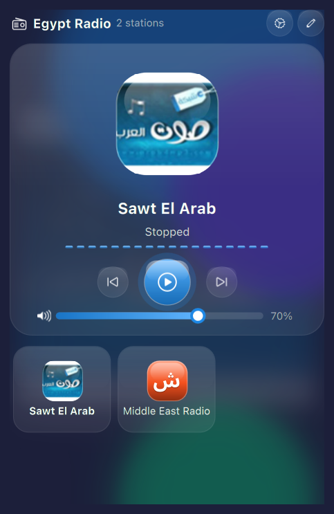
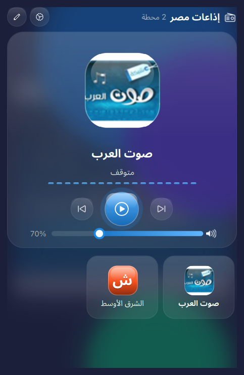
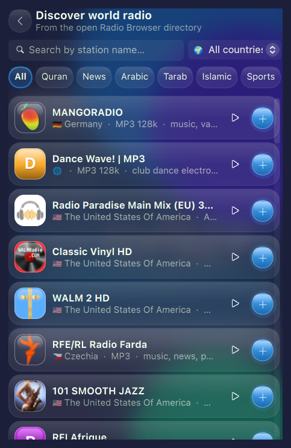

# Egypt Radio — إذاعات مصر

A KDE Plasma 6 widget for live radio with a frosted-glass interface. It started with the official
Egyptian stations (Maspero / National Media Authority) and can play any station in the world, plus
your own music files, folders and playlists.

<p align="center">
  
  
  
</p>

## Features

- **Official Egyptian stations** such as Sawt El Arab, Middle East Radio, Radio Masr, Holy Quran and
  General Program, from Maspero's public live streams.
- **Discover**: search tens of thousands of stations in the open
  [Radio Browser](https://www.radio-browser.info) directory by name, country and genre. A search in
  Arabic also finds the Latin spellings: فيروز ↔ Fairuz, أم كلثوم ↔ Kalthom.
- **Add anything**: a stream URL, a Dailymotion or YouTube live page, a local file, a whole music
  folder or an M3U/PLS playlist, with shuffle.
- **Fetch from source**: one click fills in the station name, description and logo from the
  directory, the stream's ICY headers, the station website or the video page.
- **Custom logos**: a glass letter or emoji, a system icon, an image from your computer or from a
  link, or the station's own logo.
- **Check & repair**: decodes a few seconds of every stream to confirm it actually carries audio, not
  just that the URL answers. It finds moved files and folders, restores missing logos and suggests
  replacement links that it has tested for audio.
- **MPRIS**: the widget shows up in Plasma's media controller, in audio visualizers, on the lock
  screen and on the media keys, with the station name, the song title and the cover art.
- **Responsive**: separate layouts for wide, normal, short, tiny and narrow sizes.
- **Arabic and English**: right-to-left and left-to-right layouts. The language follows the system
  or can be set in the widget settings.
- **Appearance settings**: glass opacity, animated background, logo shape, grid or list layout,
  number of columns, panel icon style and more.

<p align="center"></p>

## Requirements

- KDE Plasma 6
- `mpv` and `yt-dlp` (for playback, including Dailymotion and YouTube)
- `ffmpeg` (for the audio check)
- Python 3 with GObject introspection (`python3-gi`), for the MPRIS service
- `imagemagick` (optional, for converting `.ico` favicons)

On Debian or Ubuntu:

```sh
sudo apt install mpv yt-dlp ffmpeg python3-gi imagemagick
```

## Install

```sh
git clone https://github.com/OWNER/plasma-egypt-radio.git
cd plasma-egypt-radio
./install.sh --restart
```

Then add **Egypt Radio** from *Add Widgets…* to a panel or the desktop.

`./install.sh` on its own also updates an existing install. The `--restart` option reloads
plasmashell so the new version appears straight away.

## How it works

| Part | Role |
|---|---|
| `package/contents/ui/` | QML interface: glass components, pages and settings |
| `package/contents/code/radiod.py` | Background service. It owns one `mpv` process, reconnects when a stream drops and publishes MPRIS on D-Bus |
| `package/contents/code/radioctl.py` | Small client the widget uses to talk to the service over a unix socket |
| `package/contents/code/sources.py` | Directory search, fetching details from a source, logo download and the audio check |
| `package/contents/code/i18n.js` | Translations. The Arabic text is the key and `EN` holds the English strings |

User data lives in `~/.local/share/egypt-radio/logos/` for saved logos and in
`~/.cache/egypt-radio/art/` for the rendered cover art.

### Adding a language

Add a table like `EN` in `package/contents/code/i18n.js` and make `resolve()` and `tr()` return it.

## Notes

- The Maspero streams are the broadcaster's public live pages. The widget plays them as a normal
  viewer would and does not get around any restriction.
- Station data in Radio Browser is community-maintained, so some stations can be offline. Use
  **Check & repair** to find them.

---

## بالعربي

ودجت لسطح مكتب KDE Plasma 6 لتشغيل الإذاعات بث مباشر بواجهة زجاجية.

- **الإذاعات المصرية الرسمية** من بث ماسبيرو.
- **اكتشف:** بحث في عشرات الآلاف من الإذاعات حول العالم بالاسم والدولة والنوع. البحث بالعربي بيلاقي الأسماء اللاتينية كمان.
- **أضف أي مصدر:** رابط بث، أو صفحة Dailymotion أو YouTube، أو ملف، أو مجلد موسيقى، أو قائمة تشغيل.
- **جلب من المصدر:** بضغطة واحدة بييجي الاسم والوصف واللوجو.
- **فحص وإصلاح:** بيستمع فعلًا لكل رابط عشان يتأكد إن فيه صوت، وبيلاقي الملفات اللي اتنقلت، وبيقترح روابط بديلة جرّبها قبل ما يقترحها.
- **الظهور في متحكم الوسائط وفي الـ Visualizer**، ومعاها أزرار الوسائط وشاشة القفل.
- **واجهة بتتأقلم مع كل الأحجام**، وبتدعم العربي والإنجليزي.

**التثبيت:** شغّل `./install.sh --restart`، وبعدها ضيف «إذاعات مصر» من «إضافة عناصر واجهة».

## License

GPL-2.0-or-later. See [LICENSE](LICENSE).
